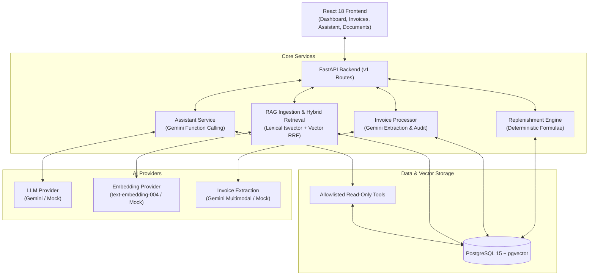

# StockWise - Pharmacy Replenishment Intelligence & Hybrid RAG System

StockWise is a clinical-grade pharmacy inventory, replenishment intelligence, and document knowledge system. It combines deterministic replenishment algorithms with genuine Google Gemini AI integrations for function-calling assistant interactions, document understanding (RAG with pgvector), and AI-powered invoice extraction.

---

## Key Features

1. **Deterministic Replenishment Engine**: Calculates stock cover, average daily demand (ADD), and reorder quantities based on historical sales, lead times, safety stock targets, and supplier minimum order quantities (MOQ).
2. **AI-Powered Invoice Extraction**: End-to-end invoice processing supporting PDF and image formats. Backed by `google-genai` multimodal extraction with full auditability (`raw_extraction_json`, `extraction_confidence`, `extraction_provider`), arithmetic line-item reconciliation, and SELECT FOR UPDATE database locking.
3. **Genuine Gemini Function-Calling Assistant**: Multi-turn conversational agent powered by Google Gemini (or deterministic mock in testing). Executes only strictly allowlisted, read-only tools with zero hallucination. Returns auditable responses with `tools_used` telemetry, `sources` provenance, and warnings.
4. **Hybrid RAG Knowledge System**: Ingestion pipeline for pharmacy SOPs, supplier policies, and monographs (PDF, DOCX, TXT) using PyMuPDF and python-docx with SHA-256 deduplication. Retrieval combines PostgreSQL full-text search (`ts_rank` on `tsvector`) and semantic vector search (`pgvector` cosine similarity) fused via Reciprocal Rank Fusion (RRF).
5. **Interactive UI**: Modern React 18 dashboard with responsive pages for Dashboard, Inventory, Replenishment Proposals, Stock Movements, AI Invoice Review, AI Assistant with tool/source chips, and Documents Knowledge Management.
6. **Comprehensive Evaluation Suite**: Dedicated evaluation tests covering tool selection accuracy (20 benchmark questions), hybrid retrieval metrics (Recall@K, MRR), invoice field extraction accuracy across 5 synthetic fixtures, and operational resilience.

---

## Technology Stack

- **Backend**: FastAPI 0.115, Python 3.10+, SQLAlchemy 2.0, Alembic, Pydantic v2
- **AI & RAG**: Google GenAI SDK (`google-genai`), `pgvector` (PostgreSQL 15), `PyMuPDF` (fitz), `python-docx`, `tenacity`
- **Database**: PostgreSQL 15 with pgvector extension (`pgvector/pgvector:pg15`)
- **Frontend**: React 18, Vite, React Router v6, Lucide Icons
- **Testing**: Pytest 8.3 / 9.1 with over 118 automated tests

---

## System Architecture



---

## Quick Start (Docker Compose)

Ensure Docker and Docker Compose are installed.

1. **Configure Environment Variables**:
   ```bash
   cp backend/.env.example backend/.env
   # Add your Google Gemini API key if testing live models:
   # GEMINI_API_KEY=your_key_here
   # AI_PROVIDER=gemini
   ```

2. **Launch Application**:
   ```bash
   docker-compose up --build
   ```

3. **Run Migrations & Seed Demo Data**:
   ```bash
   # Run Alembic migrations (including pgvector and invoice audit tables)
   docker-compose exec backend alembic upgrade head

   # Seed initial database
   docker-compose exec backend python scripts/seed_demo.py
   ```

4. **Access Applications**:
   - Web UI: [http://localhost:5173](http://localhost:5173)
   - API Docs: [http://localhost:8000/docs](http://localhost:8000/docs)
   - API Health Check: [http://localhost:8000/api/v1/health](http://localhost:8000/api/v1/health)

---

## Local Development (Without Docker)

### Backend Setup

```bash
cd backend

# Create and activate virtual environment
python3 -m venv venv
source venv/bin/activate

# Install dependencies
pip install -r requirements.txt

# Run migrations
alembic upgrade head

# Run server
uvicorn app.main:app --reload --port 8000
```

### Frontend Setup

```bash
cd frontend
npm install
npm run dev
```

---

## Configuration Reference (`backend/.env`)

| Variable | Default | Description |
|---|---|---|
| `ENVIRONMENT` | `development` | Runtime environment (`development`, `production`). |
| `DATABASE_URL` | PostgreSQL connection string | Database URL with psycopg3 driver. |
| `AI_PROVIDER` | `mock` | `mock` for deterministic test isolation; `gemini` for live API calls. |
| `GEMINI_API_KEY` | None | Google AI Studio or Cloud API key. |
| `GEMINI_MODEL` | `gemini-2.0-flash` | Gemini model for chat and document understanding. |
| `GEMINI_EMBEDDING_MODEL` | `text-embedding-004` | Gemini embedding model for RAG chunks (768-dim). |
| `INVOICE_EXTRACTION_PROVIDER` | `mock` | `mock` or `gemini` for invoice extraction. |
| `RAG_TOP_K` | `5` | Top chunks returned by hybrid search to the LLM. |
| `CORS_ALLOWED_ORIGINS` | `*` | Comma-separated list of allowed origins. |

---

## Testing & Evaluation Suite

Run the complete test suite (unit tests, e2e workflows, evaluations):

```bash
cd backend
source venv/bin/activate
pytest -v
```

### Running Specific Test Suites

```bash
# Run provider abstraction & retry tests
pytest tests/test_providers.py -v

# Run assistant function-calling tests
pytest tests/test_assistant.py -v

# Run evaluation suite (Tool selection, Retrieval Recall/MRR, Invoice Accuracy, Operational)
pytest tests/eval/ -v

# Run live Gemini integration test (opt-in when GEMINI_API_KEY is configured)
pytest tests/eval/ -m live_gemini -v
```

---

## API Endpoints Overview

- `GET /api/v1/health`: Liveness & readiness probe with live database check.
- `POST /api/v1/assistant/chat`: Grounded conversational chat with tool telemetry.
- `POST /api/v1/documents/`: Upload document (PDF/DOCX/TXT) for background chunking & embedding.
- `GET /api/v1/documents/`: List all ingested documents and indexing statuses.
- `POST /api/v1/documents/search`: Hybrid search across document knowledge index.
- `POST /api/v1/invoices/`: Upload invoice file for AI extraction.
- `GET /api/v1/invoices/{id}`: Retrieve parsed invoice with line items and validation flags.
- `POST /api/v1/invoices/{id}/approve`: Approve invoice after human verification.
- `POST /api/v1/invoices/{id}/post`: Post approved invoice lines to physical inventory batches.
- `GET /api/v1/replenishment/recommendations`: Reorder proposals computed by deterministic formulas.
